# Marco Bonetti's NixOS Configuration

This is my personal configuration, it uses [Flakes](https://wiki.nixos.org/wiki/Flakes), and it's made to handle both my Desktop PC and my Laptop, it's impermanent (via [Preservation](https://github.com/nix-community/preservation)), it uses [Hyprland](https://hypr.land/) as the window manager (configured to use the [Caelestia Shell](https://github.com/caelestia-dots/shell) for theming) and handles the userspace through [Home Manager](https://wiki.nixos.org/wiki/Home_Manager).

## Hosts

Hosts specific configuration are located inside the `hosts/` directory:

| Hostname | Hardware |
| :--- | :--- |
| **`leto-ii`** | Desktop PC |
| **`ghanima`** | Laptop PC |

## Keybinds

Werever possible, vim-style keybinds are used.



## Wallpapers

They are downloaded from my [Wallhaven](https://wallhaven.cc) profile through the `download-wallpapers.sh` script.

## Usage

To start Hyprland:

```bash
uwsm start hyprland-uwsm.desktop
```

To update when the repository changes:

```bash
sudo nixos-rebuild switch --flake ~/nixos-config#leto-ii
```

### Other NixOS useful commands

To update `flake.lock`:

```bash
nix flake update
```

To open a shell with a program available:

```bash
nix-shell -p program
```

If there is a `shell.nix` file in the current directory:

```bash
nix-shell
```

To run a program a single time:

```bash
nix run nixpkgs#program
```
